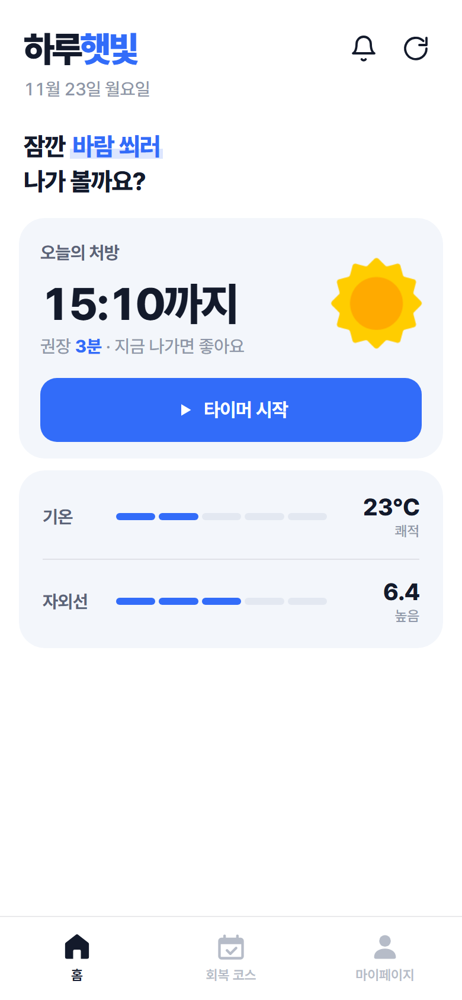
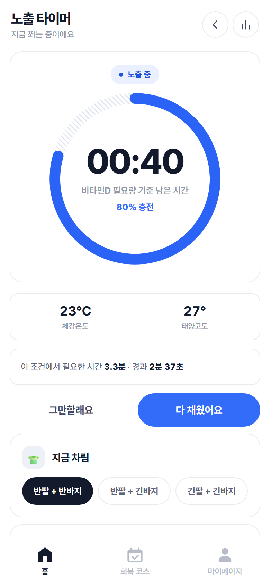
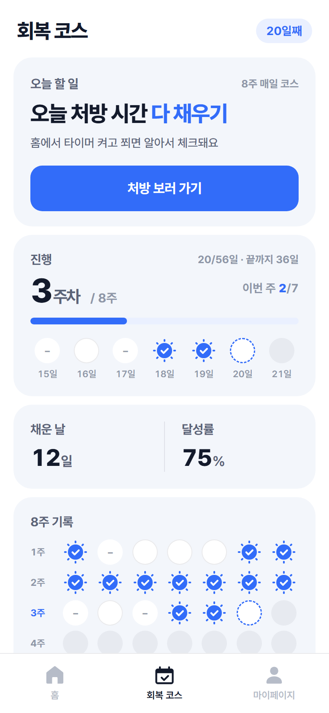
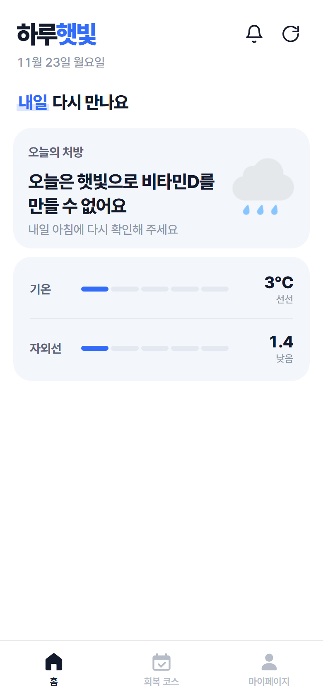
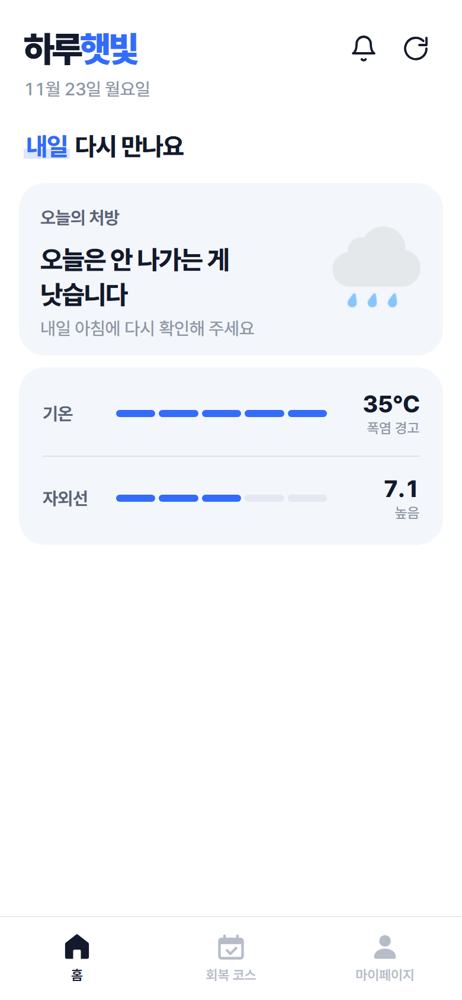
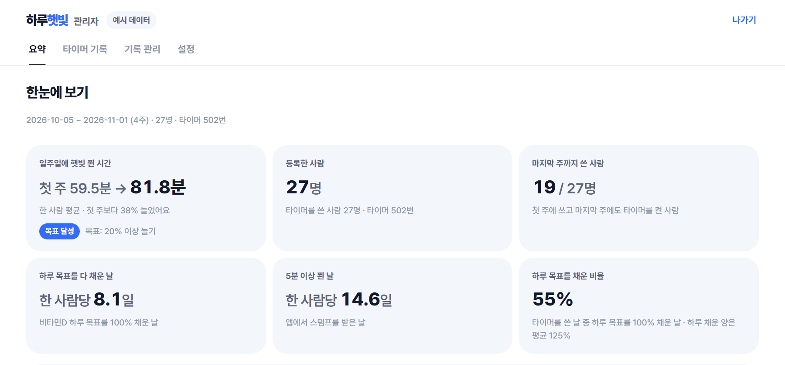
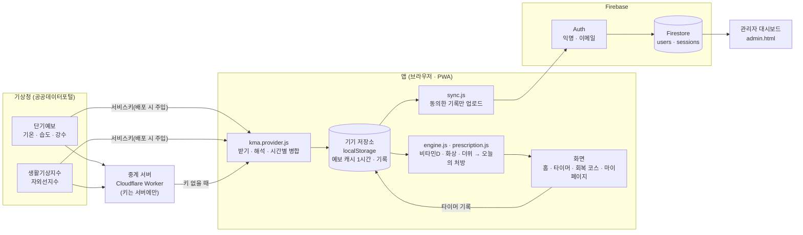
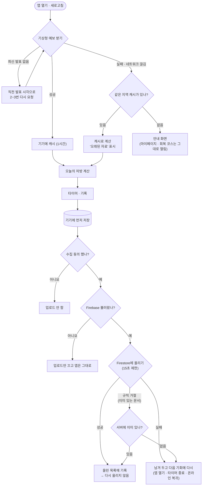
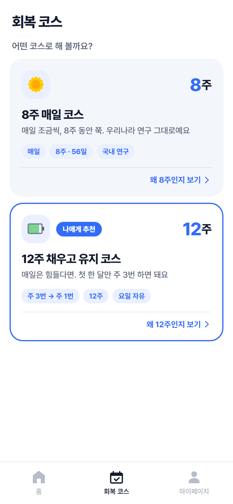
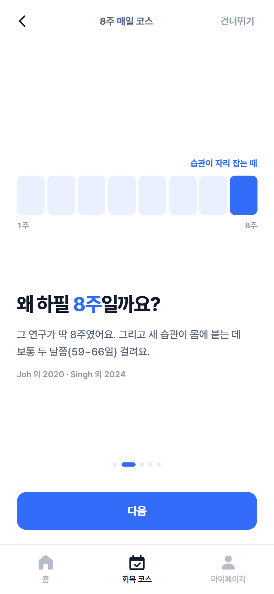

# 하루햇빛 ☀️

> 오늘 **언제, 몇 분** 햇빛을 쬐면 비타민D를 채울 수 있는지 알려 주는 웹앱

[](https://github.com/KYU-SW/haru-sunlight/actions/workflows/test.yml)
[](https://github.com/KYU-SW/haru-sunlight/actions/workflows/deploy-pages.yml)

`v_2.3` · 회복 코스 탭 (8주 · 12주) · 피부 타입 풀이 · 기온별 옷차림 자동

**바로 써 보기:** https://kyu-sw.github.io/haru-sunlight/  
**관리자 대시보드:** https://kyu-sw.github.io/haru-sunlight/admin.html  
**테스트 결과:** [자동 테스트(Actions)](https://github.com/KYU-SW/haru-sunlight/actions/workflows/test.yml) · [단위](https://kyu-sw.github.io/haru-sunlight/tests/smoke.html) · [통합](https://kyu-sw.github.io/haru-sunlight/tests/integration.html) · [실제 기상청 연결](https://kyu-sw.github.io/haru-sunlight/tests/live.html) · [Firestore 규칙(에뮬레이터)](tests/firestore/rules.test.mjs) — 절차와 결과는 [`TESTING.md`](TESTING.md)

<table><tr><td align="center"><br><sub>홈 — 오늘의 처방</sub></td><td align="center"><br><sub>타이머 — 남은 시간 · 충전률</sub></td><td align="center"><br><sub>회복 코스 — 오늘 할 일 · 기록</sub></td></tr></table>

---

## 왜 만들었나요

> **한 문단 요약** — 한국 성인 4명 중 3명 이상이 비타민D 부족이지만, 낮에 실내에 오래 있는 **20~30대 대학생 · 직장인**은
> "오늘 몇 시에, 몇 분" 햇빛을 쬐면 되는지 알 방법이 없습니다. **일반 날씨 앱**은 자외선지수 숫자만 보여 주고,
> **해외 비타민D 앱**은 한국 기상청 예보 · 폭염 기준 없이 계산하며, 둘 다 **꾸준히 하게 돕는 장치**가 없습니다.
> 하루햇빛은 기상청 예보와 내 피부 · 옷차림으로 **오늘의 처방**을 내고, **8주 · 12주 회복 코스**로 그것을 습관으로 만듭니다.

**한국 성인 4명 중 3명 이상이 비타민D 부족입니다.** 국민건강영양조사(2014)에서 혈중 비타민D가 부족(20 ng/mL 미만)한 사람은
남성 75.2%, 여성 82.5%였고, 2008년보다 더 늘었습니다 (Park 외 2018, *Medicine* 97(26):e11032).

**대상 사용자**는 낮에 실내에 오래 있는 **20~30대 대학생 · 직장인**입니다. 이들은 햇빛이 좋다는 건 알지만
"오늘, 몇 시에, 몇 분"을 알 방법이 없습니다. 날씨 앱은 자외선지수 숫자만 보여 주고, 해외 비타민D 계산 앱은
한국 기상청 예보 · 폭염 기준을 쓰지 않으며, 둘 다 **꾸준히 하게 돕는 장치**가 없습니다.
서울 20~30대 무작위 대조시험(Joh 외 2020)에서도 햇빛 그룹은 **잘 지킨 사람만** 비타민D가 올랐습니다.

하루햇빛은 **기상청 예보(자외선지수 · 기온 · 비)** 와 **내 피부 타입 · 옷차림 · 쬐는 곳** 으로
비타민D 필요 시간 · 피부가 타기 전 시간 · 더위로 안전한 시간을 계산해 **가장 짧은 값**을 오늘의 처방으로 보여 주고,
**8주 · 12주 회복 코스**로 그 처방을 습관으로 만들게 돕습니다. 모든 식과 숫자의 출처는 [`CALCULATION.md`](CALCULATION.md)에 있습니다.

## 다른 앱과 무엇이 다른가요

종류별 대표 기능 기준입니다 (○ 있음 · △ 일부 · × 없음). 개별 앱마다 차이가 있을 수 있습니다.

| 기능 | 일반 날씨 앱 | 자외선 알림 앱 | 해외 비타민D 계산 앱 | **하루햇빛** |
|---|:-:|:-:|:-:|:-:|
| 자외선지수 보기 | ○ | ○ | ○ | ○ |
| **오늘 몇 시 · 몇 분** 쬘지 계산 | × | × | ○ | ○ |
| 피부 타입 · 옷차림 · 쬐는 곳(바닥 반사) 반영 | × | △ | △ | ○ |
| 피부가 타기 전 한계 시간 | × | △ | △ | ○ |
| 폭염(체감온도 · 고용노동부 기준)으로 시간 제한 | △ | × | × | ○ |
| 비 오는 시간 빼기 | △ | × | × | ○ |
| **한국 기상청** 시간별 예보 · 생활기상지수 | ○ | △ | × | ○ |
| 타이머 · 하루 충전률 · 기록 | × | × | ○ | ○ |
| **8주 · 12주 회복 코스** (날씨별 하루 할 일, 겨울에도 이어짐) | × | × | × | ○ |
| 계산식 · 근거 논문 공개 | × | × | △ | ○ |

날씨에 따라 처방이 바뀝니다 — 자외선이 약한 겨울엔 "비타민D를 만들 수 없어요", 폭염엔 "안 나가는 게 낫습니다".

<table><tr><td align="center"><br><sub>겨울 (자외선지수 1.4)</sub></td><td align="center"><br><sub>폭염 경고 (35℃)</sub></td></tr></table>

## 기대 효과와 측정 방법

효과는 설문이 아니라 **앱 기록으로 잽니다.** 관리자 대시보드(`admin.html`)와 회복 코스 화면에서 바로 볼 수 있습니다.

| 기대 효과 | 지표 | 어디서 보나 |
|---|---|---|
| 햇빛 쬐는 시간이 는다 | 일주일에 햇빛 쬔 시간 — 첫 주 → 마지막 주 (분) | 관리자 › 한눈에 보기 |
| 하루 목표를 채운다 | 하루 목표(비타민D 100%)를 채운 날 · 쓴 날 중 채운 비율 | 관리자 › 한눈에 보기 |
| 계속 쓴다 | 첫 주에 쓰고 둘째(마지막) 주에도 타이머를 켠 사람 수 | 관리자 › 한눈에 보기 |
| 미루지 않고 나간다 | 나가기까지 지연 시간 — 앱 사용 전 → 후 (분, 현장 기록) | 관리자 › 한눈에 보기 |
| 습관이 된다 | 회복 코스 달성률 — **첫 2주 vs 마지막 2주** (%p) | 앱 › 회복 코스 (끝난 화면) |
| 안전하게 쬔다 | 타이머가 화상 · 더위 한계로 멈춘 비율 (기록의 `limitedBy`) | Firestore `sessions` |



<sub>관리자 대시보드 › 한눈에 보기. 실제 참가자 기록이 드러나지 않도록 대시보드의 <b>예시 데이터</b> 모드(`features/admin/admin.demo.js`)로 띄운 화면이며, 실제 기록일 때도 같은 구성입니다.</sub>

## 어떻게 동작하나요 (데이터 흐름)



### 오류가 나면 어떻게 되나요



| 상황 | 앱의 동작 | 코드 | 통합 테스트 |
|---|---|---|---|
| 기상청 응답 실패 · 네트워크 끊김 | 같은 지역 캐시가 있으면 그걸로 계산하고 '오래된 자료' 표시, 없으면 안내 화면 (마이페이지 · 회복 코스는 그대로 열림) | `core/weather.api.js` `load()` | 시나리오 6 · 7 |
| 최신 발표 자료가 아직 없음 | 직전 발표 시각으로 2~3번까지 거슬러 다시 요청 | `kma.provider.js` `recentBases()` | 단위 9장 |
| 자외선지수만 실패 | 기온 · 비 예보는 살리고 자외선은 0으로 보고 계산 | `kma.provider.js` `load()` | — |
| 서비스키가 없음 | 중계 서버(Cloudflare Worker)로 받음. 둘 다 없으면 키 안내 화면 | `kma.provider.js` `source()` | 단위 11장 |
| Firebase SDK를 못 불러옴 | 업로드만 꺼지고 앱은 그대로 (기기 저장 먼저) | `auth.service.js` · `sync.js` | 시나리오 8 |
| 업로드 실패 | 기록은 남겨 두고 다음 기회(앱 열기 · 타이머 종료 · 온라인 복귀)에 다시. 15초 제한 | `sync.js` `run()` | 시나리오 9 |
| 같은 기록이 두 번 올라갈 뻔함 | 문서 ID `uid_시각` + 올린 목록 기억 + 규칙상 수정 불가 | `sync.js` `uploadOne()` · `firestore.rules` | 시나리오 2 |
| 수집 동의 전 | 동의 화면이 먼저 뜨고 아무것도 올리지 않음 | `consent.js` · `app.js` `enter()` | 시나리오 10 |
| 저녁(낮 예보가 이미 지남) | 회복 코스 할 일은 낮에 정한 것을 그대로 둠 | `core/course.js` `kindFor()` | 단위 12장 |

### Firestore 구조

기록은 **기기에 먼저** 저장하고, 수집에 동의한 사람의 기록만 익명으로 올립니다. 칸 이름 · 값의 범위는 보안 규칙([`firestore.rules`](firestore.rules))이 그대로 강제합니다.

| 컬렉션 | 문서 ID | 저장하는 칸 | 쓰기 | 읽기 |
|---|---|---|---|---|
| `users` | Auth uid | `consentedAt` · `consentVersion` · `skinType`(1~6) · `sido`(시 · 도 이름) · `ageGroup`(10~70) · `bmiGroup`(5구간) · `notify` · `appVersion` · `createdAt` · `updatedAt` | 본인만 | 본인 · 관리자 |
| `sessions` | `{uid}_{시작 시각}` | `uid` · `dateKey` · `at` · `minutes`(1~600) · `percent`(0~300) · `clothing`(3종) · `limitedBy`(vitd · burn · heat) · `uploadedAt` | 본인은 **한 번 만들기만** (수정 · 삭제 불가), 관리자는 수정 시 `adminLog`에 남김 | 본인 · 관리자 |
| `adminLog` | 자동 | `at` · `by` · `action` · `target` · `before` · `after` · `reason`(1~200자) | 관리자 (**고치거나 지울 수 없음**) | 관리자 |
| `offline` | 익명 ID (영문 소문자 · 숫자 4~12자) | 현장 참가자 요약 — `records` · `setRate` · `goalDone` · `goalTotal` · `before` · `after` · `exceptions` | 관리자 | 관리자 |

- **보내지 않는 것:** 이름 · 이메일 · 좌표 · 시군구 · 나이 · 키 · 몸무게 원값 (나이는 연령대, 키 · 몸무게는 BMI 구간으로만). 규칙이 목록에 없는 칸을 거절합니다.
- **중복 · 조작 방지:** 문서 ID가 `uid_시각` 형식이 아니면 거절, 한 번 올린 기록은 참가자가 고칠 수 없음, 글자 칸은 형식 · 길이 검사(통계 오염 · CSV 수식 주입 방지).
- 위 4개 외 경로는 전부 막혀 있습니다.
- **검증:** 규칙은 Firebase 에뮬레이터(실제 Firestore 규칙 엔진)에서 24가지 경우로 검사하고(`tests/firestore/`, 푸시마다 자동),
  앱이 실제로 보내는 문서 모양은 통합 테스트 시나리오 2가 검사합니다. 실제 Firebase 프로젝트는 테스트에 쓰지 않습니다.

## 팀 · 기여

공개 커밋 기록 기준입니다 (`git shortlog -sn`).

| 이름 | GitHub 계정 | 커밋 | 맡은 일 |
|---|---|---:|---|
| 서지원 | `mnsjwn` | 48 | 계산 엔진 · 근거 정리(`CALCULATION.md`) · Firebase 연동 · 타이머 · 회복 코스 · 관리자 기록 관리 · 테스트 |
| 이상혁 | `hyeoksi` | 25 | 첫 프로토타입 · 기상청 중계 서버(Cloudflare Worker) · 지역 목록 · 화면 디자인 개편 · 기기 틀 · 서비스 워커 |
| 오지민 | `dhwlals` | 14 | 로그인 화면 · 관리자 대시보드(로그인 · 연령대/BMI 표 · 현장 기록 계산) |


## 화면 구성

| 탭 | 내용 |
|---|---|
| **홈** | 오늘의 한마디 · 오늘의 처방(언제 · 몇 분) · 회복 코스 오늘 할 일 · 기온/자외선 단계 막대 |
| **회복 코스** | 코스 고르기(8주 매일 · 12주 채우고 유지) → 코스별 소개(왜 이 기간인지, 애니메이션) → 오늘 할 일 · 진행 · 기록 · 달성률, 끝나면 첫 2주 vs 마지막 2주 비교. 화면에서 '근거 보기'로 논문 요약 (근거: `CALCULATION.md` 10장) |
| **마이페이지** | 내 햇빛 기록 · 내 정보(피부 타입 · 옷차림) · 알림 · 지역 |

<table><tr><td align="center"><br><sub>코스 고르기</sub></td><td align="center"><br><sub>코스 소개 — 왜 8주인가</sub></td></tr></table>

**타이머**는 탭이 아니라 홈에서 '타이머 시작'을 누르면 열립니다 — 밖에 있는 동안 남은 시간 · 충전률, 옷차림을 바꾸면 바로 다시 계산.

관리자는 앱 로그인 화면에서 아이디 `admin` 으로 로그인하면 **관리자 대시보드**(`admin.html`)로 넘어갑니다.
계정은 Firebase 콘솔에서 만들고, 비밀번호는 저장소에 적지 않습니다.

마이페이지 안에서 들어가는 화면

- **노출 이력** — 날짜별로 몇 분 쬐고 몇 % 채웠는지
- **이번 주 분석** — 주간 충전률 막대 · 체내 저장량 · 앞으로 며칠 예보

## 실행 방법

설치할 것 없이 정적 파일만으로 돌아갑니다. 폴더에서 아무 로컬 서버나 띄우면 됩니다.

```bash
python -m http.server 8762
```

브라우저에서 `http://localhost:8762` 를 엽니다.
컴퓨터에서는 휴대폰 틀 안에 보이고, 휴대폰에서는 앱 화면이 꽉 차게 보입니다.
휴대폰에서 **홈 화면에 추가**하면 앱처럼 아이콘으로 실행됩니다(PWA).

### 날씨 자료 (기상청 API)

- **키는 저장소 코드에 넣지 않습니다.** `config.js` 의 `KMA_SERVICE_KEY` 는 빈 값으로 둡니다.
- **배포된 사이트:** `main` 에 올라오면 `.github/workflows/deploy-pages.yml` 이
  저장소 비밀값(Settings → Secrets and variables → Actions)의 `KMA_SERVICE_KEY` 를 채워서 깃허브 페이지에 올립니다.
- **로컬 개발:** `config.local.example.js` 를 `config.local.js` 로 복사해 서비스키를 넣습니다.
  `config.local.js` 는 `.gitignore` 에 있어 깃허브에 올라가지 않습니다.
- 키가 없으면 `config.js` 의 중계 서버(Cloudflare Worker, `worker/`)로 받습니다.
- 공공데이터포털에서 **기상청_단기예보 조회서비스** · **기상청_생활기상지수 조회서비스** 두 개를 활용신청해 같은 키를 씁니다.

### 테스트 화면

푸시할 때마다 GitHub Actions(`.github/workflows/test.yml`)가 헤드리스 크롬으로 단위 · 통합 테스트를 돌립니다.
절차 · 시나리오 · 최근 결과는 [`TESTING.md`](TESTING.md).

| 주소 | 용도 |
|---|---|
| `tests/seed.html?tab=home` | 모의 날씨 · 기록을 넣고 바로 화면 확인 (`&uvi=9&temp=37` 처럼 조건 변경 가능) |
| `tests/smoke.html` | **단위 테스트** — 계산 엔진 · 좌표 변환 · 기상청 응답 파싱 · 회복 코스 (전부 PASS 여야 함) |
| `tests/integration.html` | **통합 테스트** — 실제 앱 화면을 띄워 사용자 흐름 10가지 (기상청 · Firebase는 모의) |
| `tests/live.html` | **실제 기상청 연결 확인** — 진짜 예보를 받아 앱 계산까지 (배포 사이트에서 열기) |
| `tests/firestore/` | **Firestore 보안 규칙** — Firebase 에뮬레이터로 `firestore.rules` 24가지 검사 (`npm test`, Java 21 필요) |
| `tests/timer-running.html` | 타이머가 돌아가는 상태 확인 |

## 폴더 구조

```
index.html            화면 뼈대 · 하단 탭
css/style.css         디자인 전부
core/                 계산과 데이터 (화면과 무관)
  engine.js             비타민D · 화상 · 체감온도 계산
  prescription.js       오늘의 처방 만들기
  solar.js              태양 고도 계산
  kma.geo.js            지역 목록(시·군) · 기상청 격자 변환
  weather.api.js        기상청 자료 받기 (중계 서버 / 직접)
  store.repo.js         기기 안 저장 (프로필 · 기록)
  course.js             8주 회복 코스 — 하루 할 일 · 달성률
features/             화면별 코드 (*.service.js = 로직, *.view.js = 화면)
  home/ timer/ settings/ weekly/ course/ onboarding/ login/
shared/               공통 (app.js 라우팅 · ui.js · chart.js · notify.js)
worker/               기상청 API 중계 서버 (Cloudflare Worker)
tests/                테스트 · 모의 데이터 화면 (smoke · integration · harness · live · seed)
.github/workflows/    deploy-pages.yml(배포 · 키 주입) · test.yml(자동 테스트)
```

## 알려진 한계

- 지역은 **시 · 군 단위**까지만 지원합니다. 일부 시 · 군은 기상청 시 단위 지점코드를 아직 검증하지 못해
  자외선지수를 **도 단위 값**으로 씁니다(날씨 예보는 해당 시 좌표 기준). `core/kma.geo.js` 에 `// *` 로 표시했습니다.
- 기록은 **이 기기에 먼저** 저장되고, 타이머 기록을 익명으로 Firestore에 올립니다
  (이름·이메일·좌표는 보내지 않음, 지역은 시·도 이름만). 수집 동의는 **필수**라 동의해야 앱을 쓸 수 있습니다.
  보안 규칙 원본은 `firestore.rules` 에 있습니다.
- 로그인은 **이메일 회원가입·로그인** 또는 **게스트(익명)** 입니다. 로그인하면 폰을 바꾸거나 앱 데이터를 지워도
  같은 참가자로 기록됩니다. 이메일은 로그인 확인에만 쓰고 Firestore 기록에는 담지 않습니다.
  게스트로 쓰다가 마이페이지에서 회원가입하면 같은 ID를 이어서 씁니다.
  ⚠️ Firebase 콘솔 › Authentication › 로그인 방법에서 **이메일/비밀번호를 사용 설정**해야 동작합니다.
- 프로토타입이라 오프라인(PWA 캐시) 기능은 꺼 두었습니다(`sw.js` 참고).

## 버전

| 버전 | 내용 |
|---|---|
| `v_0.1` | 프로토타입 — 홈 · 타이머 · 마이페이지 화면 개편, 노출 이력 · 이번 주 분석 분리, 지역 검색 |
| `v_0.2` | Firebase 연동 — 이메일 회원가입·로그인, 수집 동의 화면, 동의한 기록만 Firestore 전송, 스탬프, 하루 누적 한계, 로그인 화면(하늘 배경) |
| `v_0.3` | 로그인 입력 시트 2/3 높이, 수집 동의 필수화(거부 버튼 · 마이페이지 '기록 전송' 칸 제거), 동의 후 홈으로 이동, 내일 안내 문구 두 줄 |
| `v_0.4` | 관리자 대시보드(`admin.html`) — 앱 기록만으로 객관 지표(주별 햇빛 시간 · 2주 넘게 쓴 사람 · 목표 채운 날 등), 유저 수는 Firestore 인원 그대로, 설문 탭 제외 |
| `v_0.5` | 개인화 변수 추가 — 나이(휠) · 키 · 몸무게(온보딩 · 마이페이지), 타이머 '쬐는 곳'(바닥 반사), 비 오는 시간 제외, 평소 나가는 시각 추천, 온보딩 끝에 '맞춤 처방 계산 중' 화면. Firestore에는 연령대 · BMI 구간만 (동의 v2) |
| `v_0.6` | 계산식을 최신 논문 그대로 — 비타민D · 화상: Sánchez-Pérez 외 2024 (노출 비율 0.63 · 0.27 · 0.10), 더위: 고용노동부 2026 폭염 기준(33℃ 짧게 · 35℃ 오후 2~5시 X · 38℃ 중지), 바닷가 반사 0.05(Diffey 2018). 나이 · 비만 보정은 최신 연구에서 효과가 확실하지 않아 제거 (`CALCULATION.md`) |
| `v_0.7` | 관리자 대시보드 — 연령대 · BMI 구간별 표 |
| `v_0.8` | R 지수 부호 바로잡음(논문 식 6), 햇빛 시간 조건을 '고도 45°' → '자외선지수 2 이상 · 고도 20° 이상'으로 완화 (10~2월에도 시간 안내) |
| `v_1.0` | **기본 기능 완성.** 타이머 시작 전 가운데 확인 창("혹시 어디 놀러 갔다가 피부가 타진 않았나요?") — '아니요'면 바로 시작, '네'면 지역 · 피부 타입 · 차림 · 쬐는 곳을 고치는 시트(고르면 필요한 시간이 바로 다시 계산) |
| `v_1.1` | 코드 리뷰 수정 — 타이머(화면 꺼짐 · 탭 이동 · 새로고침에도 계속 셈), 안드로이드 알림(서비스 워커), 계산 예외 처리, 기록 중복 업로드 방지 · Firestore 규칙 형식 검사 · CSV 수식 주입 방지, 중계 서버 요청 범위 제한 |
| `v_1.2` | 관리자 대시보드 '기록 관리' — 기록 추가 · 수정 · 삭제, 참가자 추가 · 합치기 · 삭제(변경 내역 `adminLog`에 이유와 함께 남김), '2주 넘게 쓴 사람' → '둘째 주에도 쓴 사람'. **Firestore 규칙 다시 게시 필요** |
| `v_2.0` | **회복 코스 탭** — 하단 탭을 홈 · 회복 코스 · 마이페이지로. 코스 2개(8주 매일 · 12주 채우고 유지)를 카드로 고르고, 코스별 소개 애니메이션에서 왜 그 기간인지 설명. 날씨에 맞춘 할 일(처방 채우기 · 겨울엔 낮 빛 20~30분 · 비 · 폭염은 쉬는 날), 홈 카드, 기록 · 달성률 · 첫 2주 vs 마지막 2주, 근거 보기 시트. 근거: Joh 2020 · Lee 2020(국내 RCT 2편) · Carswell 2018 · Singh 2024 · Brown 2022 |
| `v_2.1` | 관리자 대시보드 '현장에서 모은 기록' — Firestore `offline`(현장 참가자별 요약 · 익명 ID)을 읽어 요약 · 타이머 기록에 함께 계산(지연 시간 · 예외 카드 추가, '하루에 채운 양' 칸 → 앱 · 현장 기록을 합친 '하루 목표를 채운 비율'), 설정 탭에서 익명화한 파일 올리기 · 지우기(변경 내역에 남김). **Firestore 규칙 다시 게시 필요** |
| `v_2.2` | **교수 피드백 반영** — README에 대상 사용자 · 기존 앱 한계 · 기능 비교표 · 기대 효과 측정 지표 · 데이터 흐름 그림(Mermaid) · 오류 처리 표 · 팀 기여 · 화면 캡처(`docs/images/`), 통합 테스트(`tests/integration.html`, 시나리오 10개 · 42항목), 실제 기상청 연결 확인(`tests/live.html`), 자동 테스트 워크플로(`test.yml`), [`TESTING.md`](TESTING.md) |
| `v_2.3` | 피부 타입 말 바꾸기("타다 · 그을리다" → "빨개지다 · 까매지다", 온보딩에 두 말 뜻 표시), 피부 타입 풀이(온보딩 · 마이페이지 "피부 타입이 뭐예요?" — 6단계 쉬운 설명, 펼쳐 보기), 마이페이지 **기온에 맞춰 옷차림 자동** 켜기/끄기(오늘 낮 9~18시 최고 기온 23℃↑ 반팔+반바지 · 20~22℃ 반팔+긴바지 · 20℃ 미만 긴팔+긴바지, 하루 한 번 · 같은 날 직접 바꾼 건 유지) |
