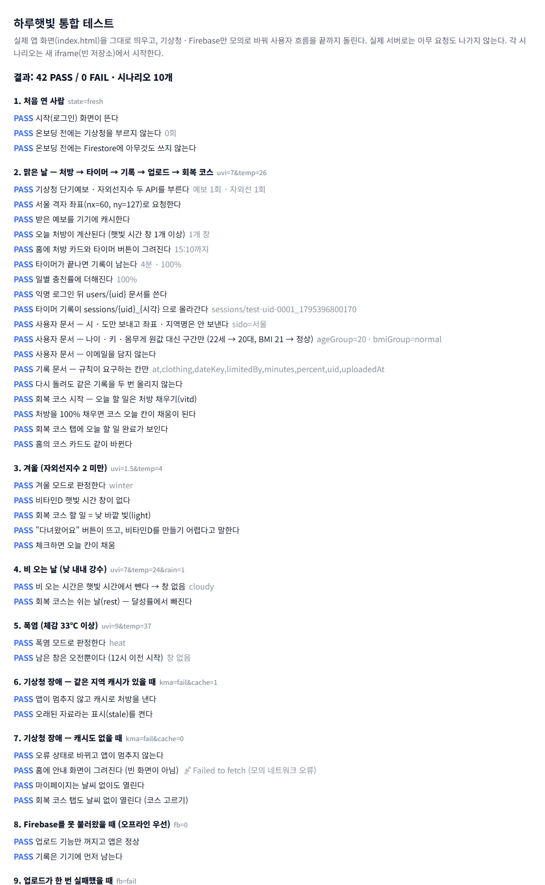
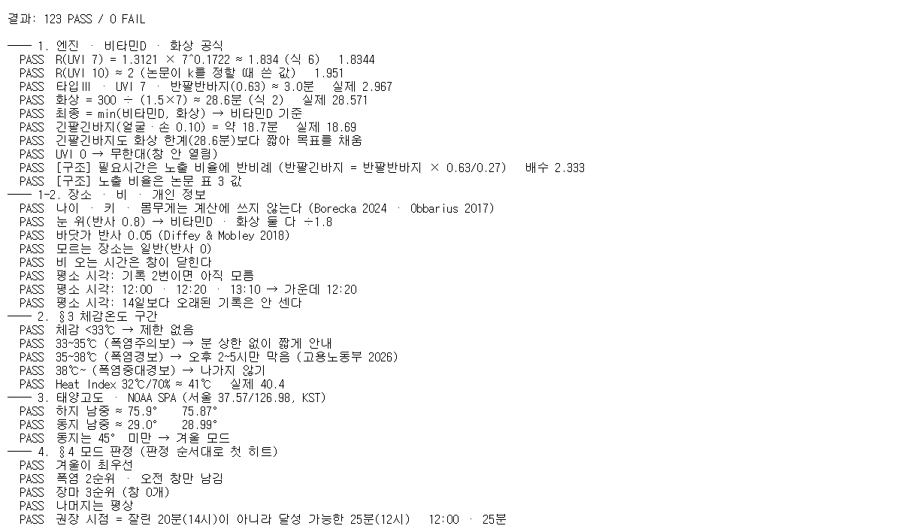

# 하루햇빛 — 테스트 절차와 결과

> 누가 언제 돌려도 같은 결과가 나오도록, 테스트는 **브라우저에서 바로 열리는 페이지**로 만들었습니다.
> 설치할 것이 없고, 푸시할 때마다 GitHub Actions가 자동으로 다시 돌립니다.

---

## 1. 한눈에 보기

| 단계 | 페이지 | 무엇을 확인하나 | 외부 호출 | 최근 결과 |
|---|---|---|---|---|
| 단위 | [`tests/smoke.html`](https://kyu-sw.github.io/haru-sunlight/tests/smoke.html) | 계산 엔진(비타민D · 화상 · 체감온도) · 태양고도 · 모드 판정 · 기상청 좌표 변환 · 응답 파싱 · 저장소 · 회복 코스 · 이유에 맞춘 조치(유지 · 다음 단계 · 끝) | 없음 | **144 PASS / 0 FAIL** |
| 통합 | [`tests/integration.html`](https://kyu-sw.github.io/haru-sunlight/tests/integration.html) | 실제 앱 화면(index.html)을 띄워 **사용자 흐름 15가지**를 끝까지 — 기상청 → 처방 → 타이머 → 기록 → Firestore 업로드 → 회복 코스, 장애 상황 | 없음 (기상청 · Firebase 모의) | **74 PASS / 0 FAIL** |
| 실제 연결 | [`tests/live.html`](https://kyu-sw.github.io/haru-sunlight/tests/live.html) · [Actions › Live KMA](https://github.com/KYU-SW/haru-sunlight/actions/workflows/live.yml) | 배포 사이트와 같은 경로로 **진짜 기상청 예보**(서울 · 부산 · 제주)를 받아 앱 계산까지 — **매일 09:00 · 배포 직후 자동 실행**, Summary에 지역별 표 | 기상청 (읽기만) | **6 PASS / 0 FAIL** |
| Firebase 규칙 | [`tests/firestore/rules.test.mjs`](tests/firestore/rules.test.mjs) | **Firebase 에뮬레이터(실제 Firestore 규칙 엔진)**에 저장소의 `firestore.rules`를 그대로 올려 31가지 검사 — 본인 기록 쓰기 · 남의 uid 거절 · 이메일 · 좌표 · 나이 원값 거절 · 값 범위 · 올린 기록 수정 · 삭제 금지 · 관리자 권한(이메일 + UID) · adminLog 수정 금지 · offline 관리자 전용 · 설문(한 주 한 번 · 조치 이름 · 단계 범위) · 그 밖 경로 차단 · **지난주 평균 자동 계산**(scripts/weekly-stats) 4가지 — 지난주만 · 관리자 제외 · 평균 숫자만 씀 | 없음 (로컬 에뮬레이터 · `demo-` 프로젝트) | **35 PASS / 0 FAIL** |
| 자동 | [Actions › Test](https://github.com/KYU-SW/haru-sunlight/actions/workflows/test.yml) | 푸시 · PR마다 단위 + 통합(헤드리스 크롬) + Firebase 규칙(에뮬레이터)을 실행, 결과를 Summary 표로 공개 | 없음 | 배지 참고 ↓ |

[](https://github.com/KYU-SW/haru-sunlight/actions/workflows/test.yml)

최근 결과 기준: 2026-11-23 (v_2.5) · 단위 · 통합은 로컬 Chrome 헤드리스와 Actions(ubuntu-latest · Chrome · `TZ=Asia/Seoul`)에서 같은 결과, Firebase 규칙은 Actions(Java 21 · firebase-tools 15.37 · Firestore 에뮬레이터)에서 35 PASS (규칙 31 + 주간 평균 4).
실제 연결은 2026-11-23 14:45 KST, 중계 서버 경로 · 평균 응답 약 1.7초 (겨울이라 세 곳 모두 '겨울 모드' 판정).

<table><tr>
<td valign="top"><br><sub>통합 테스트 — 42 PASS / 0 FAIL (v_2.2 캡처)</sub></td>
<td valign="top"><br><sub>단위 테스트 — 124 PASS / 0 FAIL (윗부분)</sub></td>
</tr></table>

## 2. 실행 방법

### 브라우저에서 (가장 쉬움)
배포 사이트에서 위 표의 링크를 열면 바로 돌아갑니다. 맨 위 줄에 `결과: N PASS / M FAIL`, 탭 제목에 `ALL PASS N`이 뜹니다.

### 로컬에서
```bash
python -m http.server 8762
# 브라우저로 열기
#   http://localhost:8762/tests/smoke.html
#   http://localhost:8762/tests/integration.html
#   http://localhost:8762/tests/live.html   (config.local.js의 키 또는 중계 서버 사용)
```

### Firebase 규칙 (에뮬레이터)
```bash
cd tests/firestore
npm install
npm test        # firebase emulators:exec → node --test rules.test.mjs (Java 21 필요)
```
실제 Firebase 프로젝트에는 접속하지 않습니다 — 로컬 에뮬레이터에 `demo-haru-sunlight` 프로젝트로 띄웁니다.

### 명령줄에서 (CI와 같은 방식)
```bash
google-chrome --headless=new --disable-gpu --virtual-time-budget=60000 \
  --dump-dom http://localhost:8762/tests/integration.html | grep -o "결과: [0-9]* PASS / [0-9]* FAIL"
```
`.github/workflows/test.yml`이 이 명령으로 두 페이지를 돌리고, 하나라도 FAIL이면 실행을 실패로 표시합니다.

## 3. 통합 테스트는 어떻게 만들었나

- `tests/harness.html`이 **실제 `index.html`을 읽어** 화면 틀과 스크립트를 그대로 불러옵니다 (앱 코드를 복사하지 않음).
- 바깥으로 나가는 것만 바꿉니다.

| 바꾼 것 | 어떻게 | 왜 |
|---|---|---|
| `fetch` | 기상청 응답과 **똑같은 JSON 모양**(단기예보 TMP · REH · PTY, 생활기상지수 h0\~h75)을 돌려줌. 맑음 · 겨울 · 비 · 폭염 · 장애를 쿼리로 바꿈 | 날씨에 따라 달라지는 흐름을 언제든 재현 |
| `firebase` | 가짜 익명 로그인 · Firestore. 쓴 문서를 모두 기록해 검사 | 실제 서버에 테스트 계정 · 기록을 만들지 않기 위해 |
| `localStorage` | 메모리 저장소 | 실제 앱 기록을 건드리지 않고, 시나리오마다 빈 상태에서 시작 |
| 시계 | 오늘 오전 10시 30분으로 고정 | 밤에 돌려도 같은 결과 |

- 시나리오마다 **새 iframe**에서 앱을 처음부터 켭니다.

## 4. 시나리오 (통합 테스트)

| # | 사용자 상황 | 확인하는 것 |
|---|---|---|
| 1 | 처음 연 사람 | 시작 화면이 뜬다 · 온보딩 전에는 기상청 · Firestore를 부르지 않는다 |
| 2 | **맑은 날, 처방대로 쬔 사람** | 기상청 두 API 호출(서울 격자 60,127) · 캐시 · 처방 계산 · 홈 카드 → 타이머 10분 → 기록 · 충전률 → 익명 로그인 → `users` · `sessions` 업로드 → **보내는 값 검사**(시 · 도만, 연령대 · BMI 구간만, 이메일 없음, 규칙이 허용한 칸만) → 다시 돌려도 중복 없음 → 회복 코스 시작 · 처방 100% → 코스 칸 채움 · 홈 카드 반영 |
| 3 | 겨울 (자외선지수 2 미만) | 겨울 모드 · 햇빛 창 없음 · 코스 할 일 = 낮 바깥 빛 · "다녀왔어요" 체크 → 채움 |
| 4 | 비 오는 날 | 비 오는 시간 제외 → 창 없음 · 코스 = 쉬는 날 |
| 5 | 폭염 (37℃) | 폭염 모드 · 오후 창 없음 |
| 6 | 기상청 장애 + 캐시 있음 | 앱이 멈추지 않고 캐시로 처방 · '오래된 자료' 표시 |
| 7 | 기상청 장애 + 캐시 없음 | 오류 안내 화면 · 마이페이지와 회복 코스는 그대로 열림 |
| 8 | Firebase를 못 불러옴 | 업로드만 꺼지고 앱 정상 · 기록은 기기에 먼저 |
| 9 | 업로드가 한 번 실패 | 기록이 남아 있다가 다음 기회에 올라감 |
| 10 | 수집 동의를 안 한 사람 | 동의 화면이 먼저 · 동의 전 업로드 0건 |
| 11 | 지난주에 쓴 사람 (평균 있음) | 타이머를 끝내면 가운데 팝업 · "다른 사람들은 평균 55% 채웠는데, 나는 67%" · 못 쬔 이유(깜빡) → `surveys/{uid}_{주}` (허용된 칸만) · 알림 켜기 제안 · 같은 주엔 다시 안 뜸 · 이유별로 앱이 바뀜(탈까 봐 → 홈에 화상 한계 시간, 시간 → 12주 추천) |
| 12 | 지난번에 이유를 고른 사람 | 내 기록만 보여 줌 · "지난번엔 '깜빡해서'라고 하셨죠. 그 뒤로 33% → 67% 늘었어요" · 닫아도 그 주엔 다시 안 뜸 |
| 12-1 | 지난주에 조치(햇빛 알림)를 켠 사람 · 기록이 줄어듦 | 이유 대신 "지난번에 바꾼 '햇빛 알림', 도움이 됐나요?" 하나 · '별로였어요' → `surveys`에 nothelped · fix=notify · 다음 단계(30분 전 알림)로 바뀌고 알림 시각도 30분 전 |
| 12-2 | 조치(짧게 나눠 쬐기)가 도움 된 사람 | '도움 됐어요' → 그대로 두고 확인 끝 · 홈 처방에 "바쁘면 N분씩 두 번 나눠 쬐어도 돼요" · 알림은 15분 전 그대로 |
| 13 | 회복 코스 · 날씨 이유 · 두 코스 같이 | 두 코스 같이 하기('코스 고르기' → '하는 중' 표시 → 다른 코스 시작 → 전환 버튼 2개 · "다녀왔어요" 한 번에 두 코스 채움 · 하나만 그만두기) · 날씨 이유 → 햇빛 없는 날 '바깥 빛 20~30분으로 대신해요' · 코스 중인 겨울날 인사말 · 따로 칸 없이 추천 코스 카드에 '나에게 추천'과 이유(22세 · 기록 없음 → 8주) → 누르면 그 코스 소개 |

## 5. 실제 기기에서 확인할 것 (체크리스트)

자동화하기 어려운 부분은 발표 전 휴대폰에서 직접 확인합니다.

| 항목 | 방법 |
|---|---|
| 홈 화면에 추가(PWA) 후 아이콘으로 실행 | 안드로이드 크롬 · iOS 사파리 '홈 화면에 추가' |
| 화면을 끄거나 다른 앱으로 갔다 와도 타이머가 이어짐 | 타이머 시작 → 1분 뒤 화면 끄기 → 돌아와서 남은 시간 확인 |
| 알림 | 마이페이지 › 햇빛 알림 켜기 → 처방 시각 알림 |
| 회복 코스 소개 애니메이션 | 회복 코스 탭 › 카드 누르기 → 5장 넘기기 · 옆으로 밀기 |
| 실제 Firestore 저장 | 관리자 대시보드에서 방금 쓴 타이머 기록이 보이는지 |

## 6. 운영 환경

| 구성 | 사용한 것 | 비고 |
|---|---|---|
| 앱 호스팅 | GitHub Pages (`main` 푸시 → `deploy-pages.yml`) | 배포 때 저장소 비밀값으로 기상청 키 주입, CSS · JS 주소에 커밋 번호를 붙여 캐시 무효화 |
| 날씨 | 공공데이터포털 기상청 단기예보 · 생활기상지수 | 하루 호출 한도 1만 번 · 앱은 1시간 캐시 |
| 중계 서버 | Cloudflare Worker (`worker/kma-proxy.js`) | 키가 없을 때 경로 · 요청 범위 제한 |
| 로그인 · 기록 | Firebase Auth(익명 · 이메일) · Firestore | 보안 규칙 원본 `firestore.rules` |
| 브라우저 | Chrome · Safari 최신 (ES5 문법 · 번들러 없음) | 자동 테스트는 Chrome |
